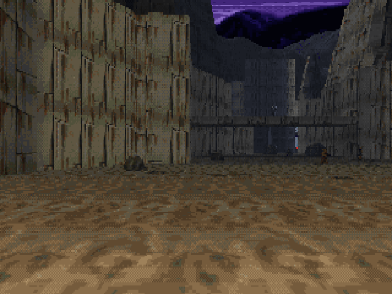
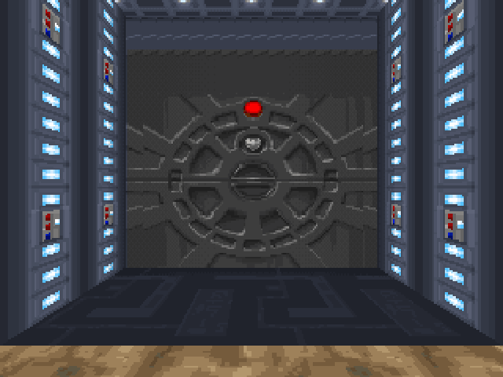
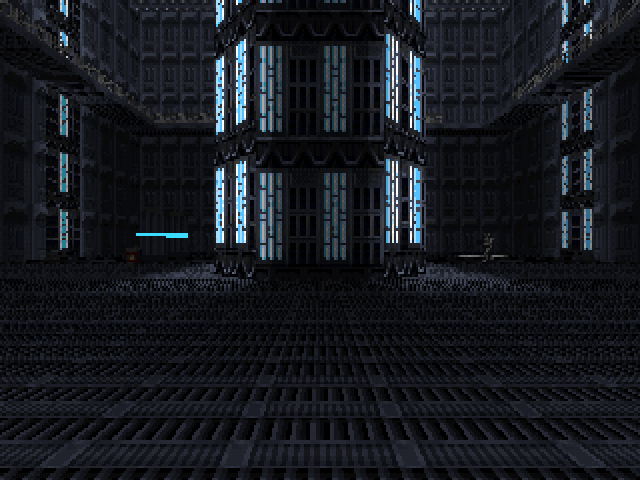

# ROGUE CONTRACT

> **Work in progress: a Dark Forces-style Star Wars fan game for the
> browser.** A non-commercial fan project. See [PLAN.md](PLAN.md) for
> what's next.

Tatooine, a few months before *Dark Forces*. Kyle Katarn takes a bounty
contract as cover for the Alliance, and the contract turns on him. The
story is in [docs/story.md](docs/story.md); the one mission built so far is
the Canyon Garrison ([docs/mission1.md](docs/mission1.md)): an Imperial base
dug into a desert canyon at night, with snipers on the ledges, a crawl
vent, a data vault and a generator to overload on the way out.


| | |
|---|---|
|  |  |
|  | |

It runs on its own engine, in plain JavaScript with no dependencies: a
grid raycaster grown into something close to Dark Forces' engine, with
floor and ceiling heights per tile, two storeys (bridges you walk under),
angled walls, rising doors, lifts, railings and grates, 3D models, smooth
placed lighting, a particle system, and enemies drawn from every side.

## Play

The game lives at **https://mjvdw13.github.io/rogue-contract/**, in any
modern desktop browser. Click the game to capture the mouse.

| Action | Keyboard and mouse | Gamepad |
|---|---|---|
| Move / strafe | W A S D, arrow keys | Left stick |
| Turn | Mouse, ← → | Right stick |
| Look up / down | Mouse (Mouse Look in Options), Page Up / Page Down, End to centre | Right stick |
| Jump | Space | A |
| Crouch | C (hold) | B |
| Fire | Left click, F, Ctrl (hold to wind up a thermal detonator) | Right trigger |
| Use / open | E, right click | X |
| Run | Shift (or Always Run in Options) | |
| Weapons | 1 fists, 2 blaster, 4 thermal detonator, 9 concussion rifle; mouse wheel, Q | Bumpers |
| Automap | Tab or M (zoom with + and -) | Back / Select |
| Menu | Esc | Start |

**Skill levels:** Recruit, Smuggler, Mercenary, Bounty Hunter and No
Witnesses.

**Cheats** (type them during play): `iddqd` (invincible, toggles), `idkfa`
(every weapon, keycard, full ammo and shields), `mercenary` (all of that and
invincible), `idclip` (walk through walls), `iddt` (reveal the map),
`idclev##` (warp).

## Run it locally

ES modules don't load from `file://` URLs, so serve the folder:

```sh
npm run serve        # http://localhost:8080
```

Handy URL parameters:

| Parameter | Effect |
|---|---|
| `?map=m1` | Straight into a level (`&skill=1`..`5`, default 3). `?map=sandbox` is the engine test map, with every enemy and villager |
| `&god` / `&nomonsters` / `&all` | Invincible / no monsters / every weapon |
| `&wide=0` | The 4:3 frame instead of widescreen |
| `&crt=off` / `subtle` / `full` | CRT effect (also in Options) |
| `&gl=0` | Plain 2D canvas instead of WebGL |
| `&fps` / `&mute` / `&seed=N` | Frame counter / no sound / fixed random seed |

`tools/particles.html` is a bench for particles and explosion styles, and
`tools/soundboard.html` plays every sound, synthesized and recorded.

## Development

Node 20 or newer, for the tools only. The game itself has no build step and
no dependencies: the repository root is the website.

```sh
npm test             # unit and simulation tests, and a minute of play in every level
npm run validate     # check all content, assets and level layouts
npm run smoke        # browser smoke test (needs Playwright; see tools/smoke.mjs)
npm run art          # regenerate the built-in art (tools/art/generate.mjs)
node tools/snapshot.mjs m1 --custom --at 48,42,90   # render a 3D view to a PNG
node tools/mapview.mjs m1                           # draw a level map to a PNG
```

GitHub Actions runs the tests, the validator and the smoke test on every
push, and GitHub Pages serves `main`.

- **[MODDING.md](MODDING.md)**: how to add monsters, weapons, items,
  scenery, particles, explosions, levels, textures, sounds and music.
- **[CLAUDE.md](CLAUDE.md)**: how the code is laid out and how work is done
  here (written for coding agents, useful for people too).

```
index.html, css/        the page
src/main.js             boots the game from the content pack
src/engine/             the engine: renderer, world, AI, audio, UI, scenes (knows no game)
src/content/            Rogue Contract as data: levels, monsters, weapons, sounds, music...
assets/                 generated textures, sprites and UI art
assets/custom/          Dark Forces art and sounds, character sheets and their cutters
tools/                  validator, map viewer, snapshot, smoke test, art generators
tests/                  node --test tests
docs/                   story, Mission 1 design, the plan's archive
```

## Art and sound

The committed generated art (`tools/art/`) and synthesized sounds are what
the tests see, and the fallback for everything. On top of them the game
loads Dark Forces' own sprites, textures and sound effects from
`assets/custom/`, through `overrides.json` and `sound-overrides.json`. Read
[assets/custom/DISCLAIMER.md](assets/custom/DISCLAIMER.md): that material
belongs to its owners and must not be redistributed. The sandtroopers, the
Jawa and the villagers are drawn from sheets made for this game. The music
is original.

## How it works

- A framebuffer of palette indices, 200 rows tall and 320 to 560 columns
  wide (it follows the window's shape; the centre 320 columns are always
  the 4:3 view). One 256-colour palette fitted to the art, 32 colormaps for
  light and distance, and fullbright colours that glow in the dark.
- A column renderer that walks each ray through the grid, drawing step
  faces, slab edges, angled walls and door panels as it goes, then fences,
  3D models, sprites and particles clipped against what it found.
- Light kept at tile corners and blended across surfaces, baked from placed
  light sources with shadows, plus dynamic light from bolts, muzzle flashes
  and explosions, and an outdoor haze.
- Monsters follow flow fields that know how high each body can climb, how
  far it can drop and which storey it's on.
- Sound effects are synthesized in the browser or played from the Dark
  Forces files; the music runs on a small tracker.
