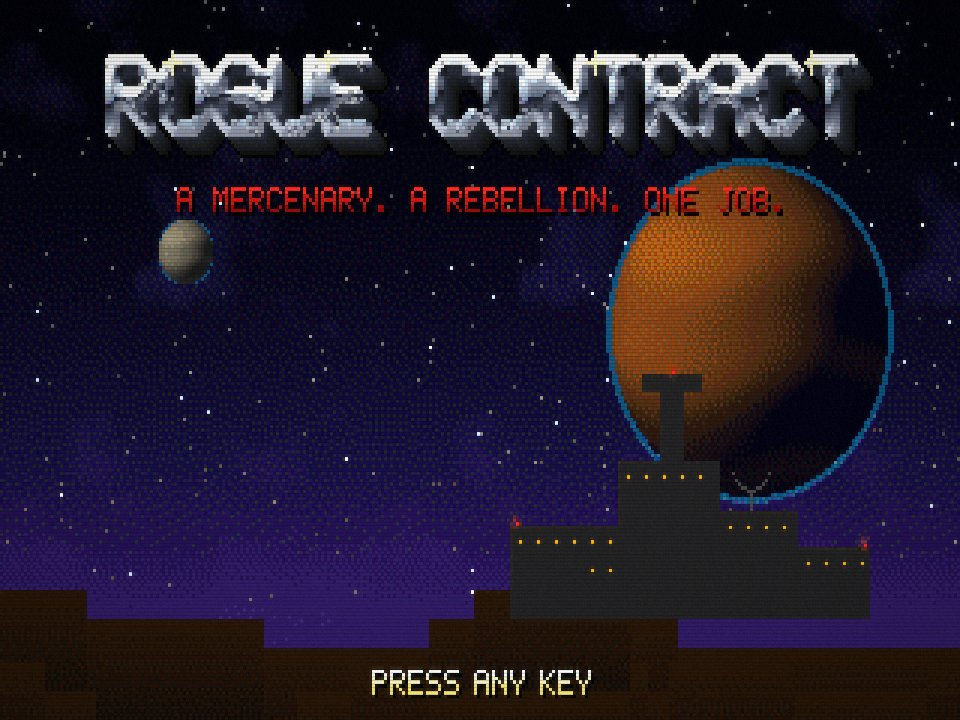

# ROGUE CONTRACT

> **Work in progress: a Dark Forces-style Star Wars fan game for the
> browser.** It's built on the Raccoon Alex engine, extended with floor and
> ceiling heights, jumping, crouching, looking up and down, rising doors,
> lifts, angled walls and two storeys (bridges you can walk under). See [PLAN.md](PLAN.md) for the roadmap.
>
> The Star Wars content hasn't landed yet: the art, levels and text below are
> still Raccoon Alex's, and they get replaced phase by phase. Try the
> height-engine test map with `?map=sandbox`. This is a non-commercial fan
> project, and all art, sound and music are original.

## Raccoon Alex (the engine's original game)

*Knee-Deep in the Deadline.* A gritty, 80s-style first-person shooter that runs
in the browser.

It's 3 AM. Alex hasn't slept in 72 hours, he's fighting the night shift in a
fuzzy raccoon costume, and the bags under his eyes are turning into a full
raccoon mask. A jammed printer has opened a portal to the Underoffice, and the
building is crawling with bugs. Fight down through the cubicles, the server
room, the basement and the sewers to the Landfill of the Damned, and smash the
Pumpkin King so Alex can finally take a nap.

The enemies are bugs, in both senses, and their queen is something worse:

| Enemy | What it does |
|---|---|
| Off-By-One Ant | Weak and always a step off. Spits acid, and drops the staples it hoards. |
| Exception Firefly | Hovers about and throws exceptions: burning ones. |
| Race Condition Roach | Fast, and always gets there first. All bite. |
| Deadlock Beetle | A huge stag beetle whose mandibles cross and lock. Spits glowing acid. |
| Memory Leak Mite | Small and quick, and there are always more of them. |
| Garbage Collector | A dung beetle that rolls the trash into a ball and throws it at you. |
| The Pumpkin King | The queen of the infestation: a huge, evil pumpkin floating on writhing vines, glaring out of a jagged hole carved in its side. Spits flaming jack-o'-lanterns and cackles for backup. |

Alex isn't the only one pulling an all-nighter. Dale, Vera, Gus, Terry and
Benny are wandering the floors too. They're friendly: shots go straight through
them, and the bugs ignore them. Bump into one, or press use, to say hi.



| | |
|---|---|
|  |  |
|  | |

## Play

The game lives at **https://mjvdw13.github.io/rogue-contract/**. It runs in any modern desktop or
mobile browser. Click the game to capture the mouse.

| Action | Keyboard and mouse | Gamepad | Touch |
|---|---|---|---|
| Move / strafe | W A S D, arrow keys | Left stick | Left half of the screen |
| Turn | Mouse, ← → | Right stick | Drag on the right half |
| Look up / down | Mouse (Mouse Look in Options), Page Up / Page Down, End to centre | Right stick | Drag on the right half |
| Jump | Space | A | JUMP |
| Crouch | C (hold) | B | DUCK (hold) |
| Fire | Left click, F, Ctrl | Right trigger | FIRE |
| Use / open | E, right click | X | USE |
| Run | Shift (or Always Run in Options) | | |
| Weapons | 1-6, mouse wheel, Q | Bumpers | WPN |
| Automap | Tab or M (zoom with + and -) | Back / Select | MAP |
| Menu | Esc | Start | MENU |

**Skill levels:** I Slept Fine, One More Episode, Red-Eye Flight, All-Nighter
and INSOMNIA!

**The episode:** E1M1 Cubicle Farm, E1M2 The Server Room, E1M3 Sub-Basement,
E1M4 The Sewers and E1M5 Landfill of the Damned. Each level has three secrets.
Doors marked with a blue, yellow or red badge need that badge.

**Cheats** (type them during play): `iddqd` and `nap` (well rested: god mode),
`idkfa` and `espresso` (everything), `raccoon` (god mode and everything),
`idclip` (walk through walls), `iddt` (reveal the map), `idclev##` (warp, for
example `idclev13` for E1M3).

## Publish on GitHub Pages

The repository root *is* the website. There is no build step, and every path is
relative, so it works at `https://<user>.github.io/rogue-contract/`.

1. On GitHub, open **Settings → Pages**.
2. Under **Build and deployment**, choose **Deploy from a branch**.
3. Pick the `main` branch and the **/ (root)** folder, then save.
4. After a minute the site shows up at the address on that page.

The `.nojekyll` file tells Pages to serve the files as they are. If you host
the game anywhere else, update the `og:` link-preview URLs at the top of
`index.html`, so shared links show the title screen.

## Run it locally

ES modules don't load from `file://` URLs, so serve the folder instead:

```sh
npm run serve        # npx http-server on http://localhost:8080
# or
python3 -m http.server 8080
```

Handy URL parameters for testing:

| Parameter | Effect |
|---|---|
| `?map=e1m3` | Jump straight into a level (`&skill=1`..`5`, default 3). `?map=sandbox` is the height-engine test map |
| `&god` / `&nomonsters` / `&all` | God mode / no monsters / all weapons |
| `&crt=off` / `subtle` / `full` | CRT effect (also in Options) |
| `&gl=0` | Plain 2D canvas instead of WebGL |
| `&fps` | Frame counter |
| `&mute` | No sound |
| `&seed=N` | Fixed random seed |

## Make it your own

Everything specific to Raccoon Alex is plain data in `src/content/`. The engine
in `src/engine/` never mentions him. New monsters, weapons, items, levels,
sounds and music are each a small file plus a line in an index.
**[MODDING.md](MODDING.md)** walks through each one.

```
index.html, css/        the page (the canvas, the loading text)
src/main.js             boots the game from the content pack
src/engine/             the engine: renderer, world, AI, audio, UI, scenes
src/content/            Raccoon Alex: palette, levels, monsters, coworkers,
                        weapons, items, sounds, music, strings, hero, cheats
assets/                 PNG textures, sprites and UI art
tools/art/              the generators that drew the built-in art
tools/validate.mjs      content checks: references, files, level reachability
tools/mapview.mjs       renders levels as top-down PNGs
tools/snapshot.mjs      renders the 3D view of a level headlessly to a PNG
tools/smoke.mjs         headless-browser smoke test
tools/soundboard.html   plays every sound, synthesized and recorded, to try overrides
tests/                  node --test unit and simulation tests
```

## Development

Node 20 or newer is only needed for the tools. The game itself has no
dependencies.

```sh
npm test             # unit tests + a headless minute of play in every level
npm run validate     # check all content, assets and level layouts
npm run art          # regenerate the built-in art (tools/art/generate.mjs)
node tools/mapview.mjs e1m2        # draw a level map to tools/art/out/maps/
node tools/snapshot.mjs sandbox --at 14.5,4.5,0 --pitch 30   # render the 3D view to a PNG
npm run smoke        # browser smoke test (needs Playwright, see the file)
```

GitHub Actions runs the tests, the validator and the smoke test on every push.

## How it works

- A 320×200 framebuffer of palette indices, drawn with a grid raycaster. The
  view fills the screen; shield, health, ammo and keys sit in small panels in
  the bottom corners, as in Dark Forces. It has textured floors and
  ceilings, skies, sliding doors and Doom-style light falloff through 32
  colormaps.
- Every PNG is snapped to one 256-colour palette when it loads. The last 31
  colours are fullbright, so eyes, fire and screens glow in the dark.
- On a widescreen window the framebuffer grows wider instead of showing
  black bars: 426×200 at 16:9, up to 560×200 at 21:9. The centre 320
  columns stay exactly the 4:3 view, and the HUD and menus stay in them.
- The picture is scaled with nearest-neighbour sampling (each pixel 1.2x
  taller than wide, as on a 4:3 VGA screen), through an optional WebGL CRT
  shader (scanlines, curvature, grain). A plain canvas is used if WebGL
  isn't available.
- Monsters follow a flow field toward the player. Gunfire wakes up every
  monster within earshot. Monsters that hit each other start fighting.
- Coworkers are friendly NPCs: solid but not shootable, so every attack passes
  through them. They stroll around their spot and react when bumped or used.
- Sound effects are synthesized in the browser and the music runs on a small tracker.
  There are no audio files.
- The built-in art is generated by `tools/art/`. The bugs, weapons and
  scenery come from a software "clay" renderer (depth, normals, ambient
  occlusion and specular), dithered into the palette. Alex, the coworkers and
  the Pumpkin King are hand-drawn pixel grids with painted, dithered shading.
